# Jira Xray
This chapter explains how to set up the **AST Control Panel** to integrate with **Jira** using the **Xray** test management app. This integration allows you to link your automated test cases to Xray tests, send execution results to an Xray Test Execution, and view the synchronization status and logs directly from AST.

!!! info
    The integration uses the Xray REST API v2 (`/rest/raven/2.0/...`) of **Xray for Jira Server / Data Center**. Xray Cloud uses a different API and authentication and is not supported by the default configuration.

### Configuration Settings

To enable the integration, an administrator must navigate to **Admin → Configuration** in the **AST Control Panel**:

1. **Enable Integration**: In the *General* section set **Xray enabled** (`ast-control-panel.integration.xray.enabled`) to **true**. The *Xray* section with the remaining properties becomes available.
2. **Enter Connection Details**: In the *Xray* section fill in the following properties and press `Save Changes`.

| Property       | Description                                                                                                                                                                                                                | Default                               |
|----------------|----------------------------------------------------------------------------------------------------------------------------------------------------------------------------------------------------------------------------|---------------------------------------|
| Url            | Base URL of your Jira instance, for example `https://jira.yourcompany.com`. The sync endpoint is appended to this URL.                                                                                                     | –                                     |
| Token          | Jira Personal Access Token of the technical user that is used for the synchronization. It is sent as a `Bearer` token in the `Authorization` header. The user needs permission to import executions in the target project. | –                                     |
| Sync enabled   | Flag to enable or disable sending of results to Xray. When set to false, External Xray IDs can still be maintained, but no results are sent and **Resend to Xray** is rejected.                                            | `true`                                |
| Status mapping | Mapping of AST execution results to Xray test run statuses.                                                                                                                                                                | See [Status mapping](#status-mapping) |
| Custom fields  | Mapping of AST data (test steps table, report link) to Xray test run custom fields.                                                                                                                                        | `[]` (no custom fields), see [Custom fields](#custom-fields) |

Results are only sent to Xray when both **Xray enabled** and **Sync enabled** are set to true.

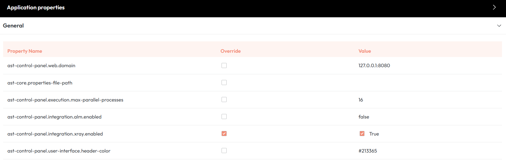
<figcaption>Configuration to enable Xray integration</figcaption>

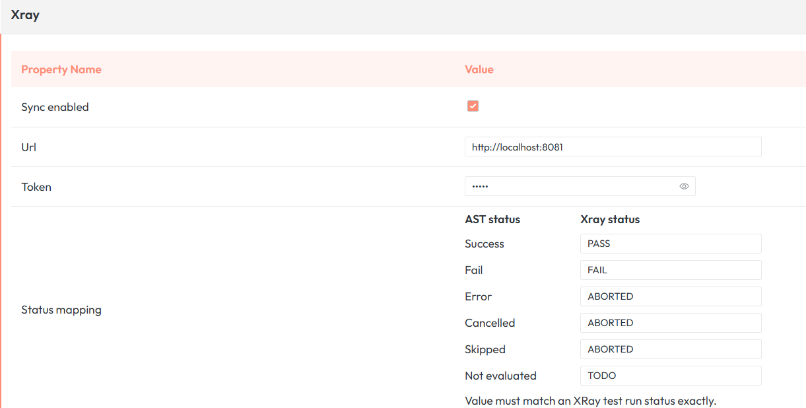
<figcaption>Xray connection settings in AST Control Panel</figcaption>

Values saved in the user interface are stored in the database and override the values from the application configuration (environment variables or the Helm `Values.yaml`). Removing a saved value restores the value from the configuration. For more details see [Administration](admin.md#configuration).

#### Setting the defaults via environment variables (Optional)
All Xray properties can also be preset via environment variables, which is useful for automated deployments:

| Environment variable                                    | Description                                                                      | Default                            |
|---------------------------------------------------------|----------------------------------------------------------------------------------|------------------------------------|
| `AST_CONTROL_PANEL_INTEGRATION_XRAY_ENABLED`            | Enables the Xray integration.                                                    | `false`                            |
| `AST_CONTROL_PANEL_INTEGRATION_XRAY_URL`                | Base URL of the Jira instance.                                                   | –                                  |
| `AST_CONTROL_PANEL_INTEGRATION_XRAY_TOKEN`              | Personal Access Token used for the synchronization. Store it as a secret.        | –                                  |
| `AST_CONTROL_PANEL_INTEGRATION_XRAY_SYNC_ENABLED`       | Enables sending of results to Xray.                                              | `true`                             |
| `AST_CONTROL_PANEL_INTEGRATION_XRAY_STATUS_MAPPING`     | Default status mapping as a JSON object.                                         | See [Status mapping](#status-mapping) |
| `AST_CONTROL_PANEL_INTEGRATION_XRAY_CUSTOM_FIELDS`      | Default custom fields mapping as a JSON array.                                   | `[]`, see [Custom fields](#custom-fields) |
| `AST_CONTROL_PANEL_INTEGRATION_XRAY_SYNC_ENDPOINT`      | Path of the import endpoint, appended to the URL.                                | `/rest/raven/2.0/import/execution` |
| `AST_CONTROL_PANEL_INTEGRATION_XRAY_SYNC_ATTEMPTS`      | Maximum number of retries of a failed synchronization.                           | `3`                                |
| `AST_CONTROL_PANEL_INTEGRATION_XRAY_SYNC_DURATION`      | Initial waiting time in seconds before the first retry. See [Retries](#retries). | `30`                               |

For instructions on how to set environment variables please refer to the [Setting environment variables](deployment.md#setting-up-environment-variables) documentation.

#### Status mapping
The status mapping defines which Xray test run status is sent for each AST execution result. It can be edited in **Admin → Configuration** in the *Xray* section. Each AST status has its own input field:

| AST status    | Default Xray status |
|---------------|---------------------|
| Success       | `PASS`              |
| Fail          | `FAIL`              |
| Error         | `ABORTED`           |
| Cancelled     | `ABORTED`           |
| Skipped       | `ABORTED`           |
| Not evaluated | `TODO`              |

!!! warning "Important"
    All six values are required and every value must match an existing Xray test run status **exactly** (including custom statuses defined in your Xray instance). The changes cannot be saved while a field is empty. If a stored mapping turns out to be invalid, AST logs a warning and uses the default mapping instead.

When setting the default via the environment variable, use the internal keys:

~~~yaml
env:
  AST_CONTROL_PANEL_INTEGRATION_XRAY_STATUS_MAPPING: '{"test_success":"PASS","test_fail":"FAIL","test_error":"ABORTED","test_cancelled":"ABORTED","test_skipped":"ABORTED","not_evaluated":"TODO"}'
~~~

#### Custom fields
In addition to the status and the comment, AST can fill **Test Run custom fields** in Xray with data from the execution. The custom fields mapping defines which AST data is written into which Xray custom field. It can be edited in **Admin → Configuration** in the *Xray* section in the **Custom fields** property.

By default the mapping is empty (`[]`) and no custom fields are sent to Xray.

The following AST data can be sent:

| Value              | JSON value         | Content sent to Xray                                                                                                                                                                                       |
|--------------------|--------------------|------------------------------------------------------------------------------------------------------------------------------------------------------------------------------------------------------------|
| Test steps table   | `test_steps_table` | Table of the executed test steps in Jira wiki markup with the columns *Type*, *User*, *Description*, *Operation Type*, *Err.Message*, *Status* and *CreationTime*. Use a multi-line text field in Xray. |
| Report link        | `report_link`      | Link to the HTML report of the test case. The link is based on the **Web domain** configured in [Administration](admin.md#configuration).                                                                  |

!!! info "Prerequisite"
    The Test Run custom fields must already exist in your Jira Xray instance. AST does not create them, it only fills them. Ask your Jira administrator for the ID of each field (for example `customfield_10021`) and make sure the field type fits the content, for example a multi-line text field for the test steps table.

##### Configuring the mapping in AST
1. Go to **Admin → Configuration** and expand the *Xray* section. The section is only available when **Xray enabled** is set to true.
2. In the **Custom fields** property, click **Add field**. If no custom fields are configured yet, the property shows *No custom fields configured*.
3. In **Xray field ID**, enter the ID of the Test Run custom field in Xray, for example `customfield_10021`.
4. In **Value**, select the AST data to send to this field: **Test steps table** or **Report link**.
5. To send the second value as well, click **Add field** again and fill in the new row.
6. Press `Save Changes`. The button appears as soon as a value in the section has been changed.

<!-- TODO: add screenshot of Admin → Configuration, expanded Xray section, with two Custom fields rows (Xray field ID + Value), the Add field button and the Save Changes button visible -->
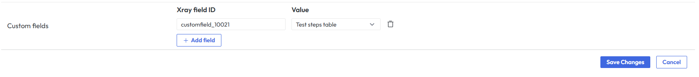
<figcaption><strong>Custom fields</strong> editor in the Xray section of the configuration</figcaption>

To remove a field, click the trash icon (**Remove field**) at the end of its row and save. If you remove all rows, no custom fields are sent to Xray.

The following rules apply:

- Both values are optional. To send only the report link, add only one row with **Report link**.
- Each value can be selected only once. A value that is already used in another row is disabled in the **Value** list, and **Add field** is disabled once both values are used.
- Each Xray field ID can be used only once and must not be empty. Leading and trailing spaces are removed when saving.
- The custom fields are sent to Xray in the order of the rows.

The rows are checked while you edit them. As long as a row is incomplete or invalid, a message is shown below the row and `Save Changes` is disabled:

| Message                               | Cause                                                       |
|---------------------------------------|-------------------------------------------------------------|
| Enter an Xray field ID.               | The **Xray field ID** of the row is empty.                  |
| This Xray field ID is already used.   | The same Xray field ID is entered in an earlier row.        |
| Select a value.                       | No **Value** is selected in the row.                        |
| This value is already used.           | The same value is selected in an earlier row.               |

A newly added row that is still empty does not show a message, but `Save Changes` stays disabled until the row is filled in or removed.

<!-- TODO: add screenshot of the Custom fields editor showing a validation message below a row and the disabled Save Changes button -->
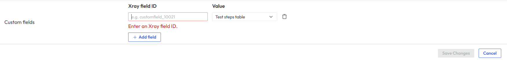
<figcaption>Validation message in the <strong>Custom fields</strong> editor</figcaption>

The mapping is stored as a JSON array, in which `test_steps_table` stands for **Test steps table** and `report_link` for **Report link**. The server validates the mapping again when it is saved. If a stored mapping turns out to be invalid (for example a wrong value set via the environment variable), AST logs a warning and uses the default mapping from the application configuration instead.

##### Resetting to the default
Once a value has been saved in the user interface, a **Reset to default** button (circular arrow icon) appears next to the **Custom fields** editor. Clicking it removes the saved value, restores the default from the application configuration (`AST_CONTROL_PANEL_INTEGRATION_XRAY_CUSTOM_FIELDS`, by default `[]`) and shows the notification **Custom fields was reset to default.**

The custom fields are only filled when a run log is available for the test case. For example, test cases that were skipped before they started are sent without custom fields.

When setting the default via the environment variable, pass the mapping as a JSON array. Each entry contains the Xray field ID (`id`) and the value (`source`: `test_steps_table` or `report_link`):

~~~yaml
env:
  AST_CONTROL_PANEL_INTEGRATION_XRAY_CUSTOM_FIELDS: '[{"id":"customfield_10021","source":"test_steps_table"},{"id":"customfield_10022","source":"report_link"}]'
~~~

After the synchronization, the values are visible in the custom fields of the test run in Xray.

#### Proxy Settings (Optional)
If the AST Control Panel can reach your Jira/Xray instance only through an HTTP proxy, configure the proxy using the following environment variables:

| Environment variable                                       | Description                                                                                    | Default |
|------------------------------------------------------------|------------------------------------------------------------------------------------------------|---------|
| `AST_CONTROL_PANEL_INTEGRATION_XRAY_PROXY_HOST`            | Hostname of the proxy server. If empty, no proxy is used.                                      | –       |
| `AST_CONTROL_PANEL_INTEGRATION_XRAY_PROXY_PORT`            | Port of the proxy server.                                                                      | `8080`  |
| `AST_CONTROL_PANEL_INTEGRATION_XRAY_PROXY_USERNAME`        | Username, if the proxy requires authentication. Optional.                                      | –       |
| `AST_CONTROL_PANEL_INTEGRATION_XRAY_PROXY_PASSWORD`        | Password, if the proxy requires authentication. Optional.                                      | –       |
| `AST_CONTROL_PANEL_INTEGRATION_XRAY_PROXY_NON_PROXY_HOSTS` | Hosts that are accessed directly, bypassing the proxy. Use Java regular expressions. Optional. | –       |

Example configuration in the `Values.yaml` file of the helm chart:

~~~yaml
env:
  AST_CONTROL_PANEL_INTEGRATION_XRAY_PROXY_HOST: "proxy.yourcompany.com"
  AST_CONTROL_PANEL_INTEGRATION_XRAY_PROXY_PORT: "8080"
  AST_CONTROL_PANEL_INTEGRATION_XRAY_PROXY_USERNAME: "proxy_user"
  AST_CONTROL_PANEL_INTEGRATION_XRAY_PROXY_NON_PROXY_HOSTS: 'localhost|127\.0\.0\.1|.*\.mycorp\.local|jira\.internal\.com'

envSecrets:
  AST_CONTROL_PANEL_INTEGRATION_XRAY_PROXY_PASSWORD:
    secretName: ast-control-panel-xray-proxy-secret
    key: password
~~~

It is recommended to store the proxy password in a Kubernetes secret and reference it via `envSecrets`, as shown above. For more details, see [Setting environment variables](deployment.md#setting-up-environment-variables).

#### SSL certificates
If your Jira instance uses a certificate signed by an internal or self-signed certificate authority, the synchronization fails with an SSL error. Import the certificate into the truststore of the application as described in [Setting up a truststore for SSL](deployment.md#setting-up-a-truststore-for-ssl). See also the [FAQ](faq.md).

### Assigning External Xray IDs to Test Cases

You must link your AST test cases to their corresponding Xray **Test** issues in Jira by assigning an **External Xray ID** (the Jira issue key of the Xray test, for example `PROJ-1042`).

!!! warning "Important"
    An External Xray ID can be assigned to only **one** test case. Saving an ID that is already used by another test case fails with the message `External XRay Id "<ID>" already exists!`.

The External Xray ID fields are only visible when the Xray integration is enabled.

#### When creating a test case

The **Create new test case** dialog contains an optional **External Xray ID** field.

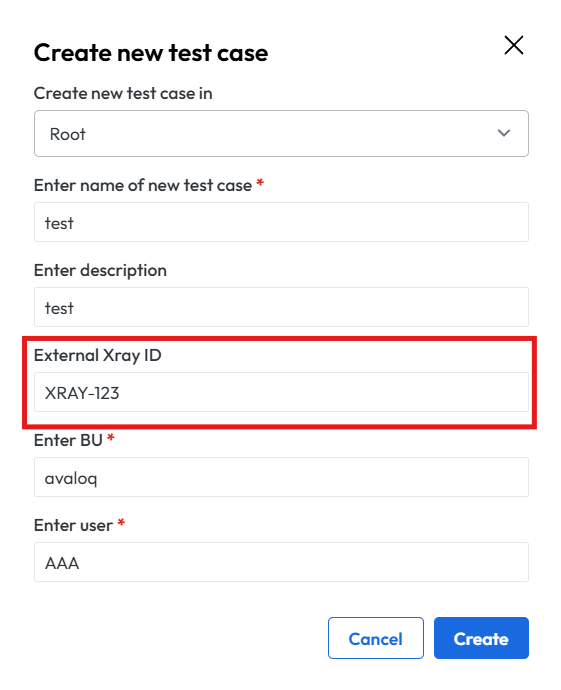
<figcaption><strong>Create new test case</strong> dialog with the <strong>External Xray ID</strong> field</figcaption>

#### Individual Assignment

1. Go to the Test tab and select a test case to open its details shown in the [details panel](test_case_repository.md#version-information-and-details-panel).
2. Click the **Xray** field, enter or change the External Xray ID and confirm. Leave the field empty to remove the link.

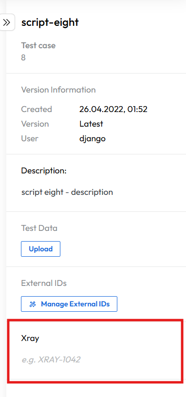
<figcaption>Test case detail with External Xray ID field</figcaption>

#### Bulk Assignment (CSV Upload)

1. Click on any test case in the repository tree to open the [details panel](test_case_repository.md#version-information-and-details-panel) and then click **Manage External IDs**. The dialog can also be opened from the **Quick Actions** on the [Landing page](navigation.md#landing-page).
2. If both Xray and ALM are enabled, choose **External Xray ID** in **External ID to update**.
3. Choose the **CSV delimiter** used in your file: comma (`,`) or semicolon (`;`).
4. Drop or select the CSV file (maximum 100 MB). The file is validated immediately and the results are listed in **Messages**.
5. Press **Upload**.

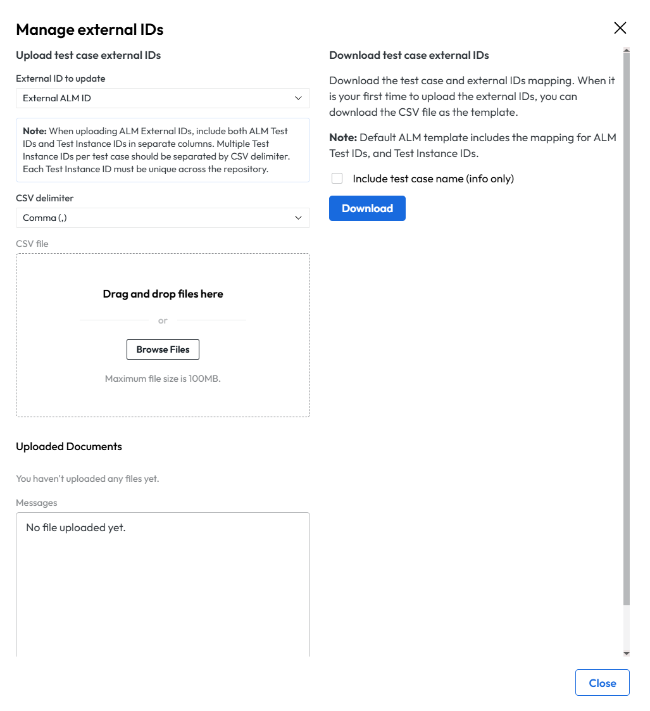
<figcaption>Dialog for managing bulk external IDs upload</figcaption>

The CSV file must contain a header row with the columns `AST Test Case ID` and `External Xray ID`. Additional columns (for example `Test Case Name`) are ignored. Example with comma as delimiter:

~~~text
AST Test Case ID,External Xray ID
1,PROJ-101
2,PROJ-102
5,PROJ-105
6,PROJ-106
~~~

During validation the following rules apply:

- **Errors** block the upload, for example a missing required column, an AST Test Case ID that does not exist, or an External Xray ID that is already used by another test case or appears more than once in the file.
- **Warnings** skip the affected row, for example a row without an External Xray ID. The skipped rows can be downloaded via **Download warning records** for review.
- **Conflicts**: if a test case already has a different External Xray ID, you are asked whether to **Replace** it or **Skip** the row.

#### Downloading the current mapping
On the right side of the **Manage External IDs** dialog you can **Download** the mapping of all test cases and their External Xray IDs as `external_xray_id_mapping.csv`. Use it as a template for your first upload. Select **Include test case name (info only)** to add the test case names for easier editing.

### Scheduling and Xray Synchronization

When you schedule a test run, select **Create Jira Xray report** in the schedule dialog and enter the **Jira Xray Execution ID**. This is the Jira issue key of the Xray **Test Execution** the results are sent to (for example `PROJ-2000`). **It is different from the External Xray ID** assigned to individual test cases. The field is mandatory when the checkbox is selected.

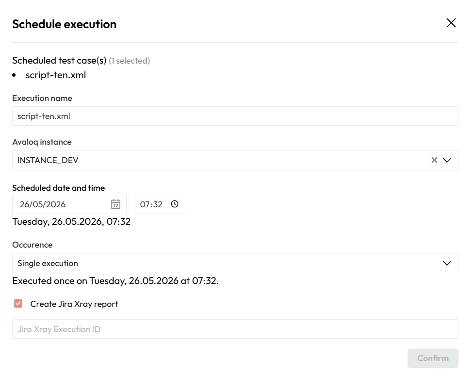
<figcaption>Schedule execution dialog with 'Create Jira Xray report' option</figcaption>

!!! info
    **Execute now** on a test set starts the execution without a Jira Xray Execution ID, so its results are not sent to Xray. Use **Schedule** if the results should be synchronized.

#### Changing the Xray Execution ID of a scheduled execution
As long as an execution has not started yet, you can change or remove its Jira Xray Execution ID:

1. In the [Executions](executions.md) table, click the scheduled execution and choose **Modify** ("Edit name, instance, schedule, or Xray settings").
2. Change the **Jira Xray Execution ID**, or clear **Create Jira Xray report** to stop sending results to Xray.
3. For recurring executions choose whether the change applies to **This occurrence** or to the **Entire series**.

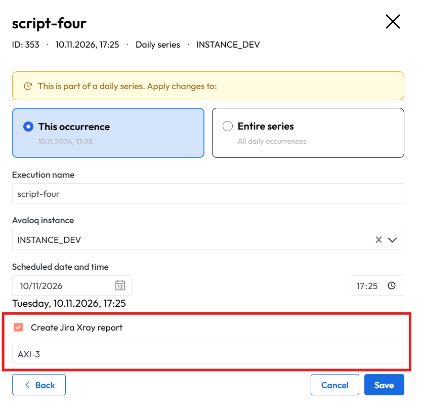
<figcaption><strong>Modify</strong> dialog of a recurring scheduled execution showing the series options and the <strong>Create Jira Xray report</strong> / <strong>Jira Xray Execution ID</strong> fields</figcaption>

#### How the synchronization works
- The results are sent **automatically after each test case finishes**, not at the end of the whole execution. Each test case creates or updates its own test run in the Xray Test Execution.
- The Xray test is identified by the test case's External Xray ID. If the test case has no External Xray ID, `testKey` is sent as `null`.
- The Xray status is determined by the [Status mapping](#status-mapping).
- The Test Run custom fields are filled according to the [Custom fields](#custom-fields) mapping.
- Before the results are sent, AST reads the defects already linked to the test run in Xray and sends them along, so re-synchronizing does not remove defect links. If the defects cannot be read, the synchronization continues without them.

#### Retries
If the Xray server cannot be reached or responds with a server error (HTTP 5xx) or `429 Too Many Requests`, the request is retried up to `AST_CONTROL_PANEL_INTEGRATION_XRAY_SYNC_ATTEMPTS` times (default 3). The first retry waits `AST_CONTROL_PANEL_INTEGRATION_XRAY_SYNC_DURATION` seconds (default 30) and the waiting time increases with each retry.

Client errors such as `400 Bad Request`, `401 Unauthorized` or `404 Not Found` (for example a wrong token, an unknown issue key or a wrong status in the mapping) are **not** retried. If all attempts fail, the test case is shown with a failed sync status and the error is stored in the sync log. You can resend the results afterwards, see [Resending results to Xray](#resending-results-to-xray).

### Viewing Reports and Sync Logs

When the Xray integration is enabled, the [Executions](executions.md) table shows the **External Xray** and **Xray sync status** columns. You can filter the executions by **External Xray ID** and by **Xray sync status** (Success, Failed, N/A).

After a test run is complete, you can review its status and troubleshoot any issues:

- **View Sync Status**: Click a row in the executions table to open the **Execution Report** window. The header shows the **External Xray ID** and the **Xray Sync Status** column shows the status and time of the last synchronization of each test case.
- **Detailed Logs**: Click **View sync logs** next to the sync status to see the response returned by Xray.
- **Manual JSON Download**: Open the **Reports** dropdown of a test case and click **Xray JSON** to download the raw JSON payload that is sent to Xray. This option is only available for test cases that finished technically and belong to an execution with a Jira Xray Execution ID.

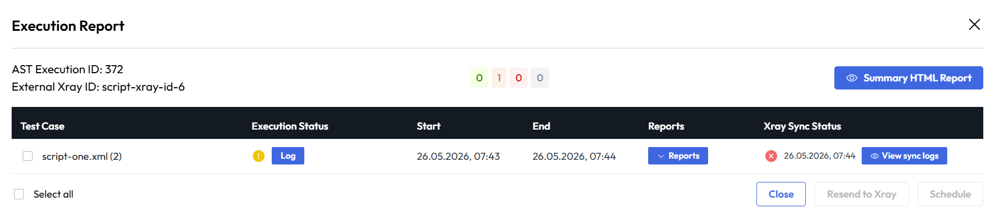
<figcaption>Execution Report window showing Xray sync status</figcaption>

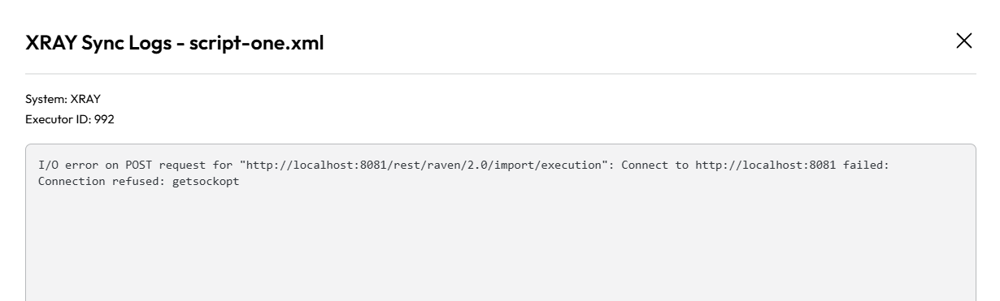
<figcaption>Log view of Xray synchronization</figcaption>

#### Sync status values

| Status  | Meaning                                                                                                                |
|---------|------------------------------------------------------------------------------------------------------------------------|
| Success | Xray accepted the results (HTTP 2xx).                                                                                   |
| Failed  | Xray rejected the request (HTTP 4xx), for example because of a wrong token, issue key or status value.                  |
| Error   | The Xray server failed or could not be reached after all retries (HTTP 5xx), or an internal error occurred in AST.     |
| Pending | The synchronization has not finished yet.                                                                               |
| Partial | Shown on execution level in the Executions table when only some test cases were synchronized successfully.              |
| N/A     | No synchronization applies, for example because the execution has no Jira Xray Execution ID.                            |

Check **View sync logs** to see the exact error returned by Xray.

#### Resending results to Xray
If the synchronization failed, or the results should be sent again (for example after correcting the External Xray ID or the status mapping):

1. Open the **Execution Report** window of the execution.
2. Select the test cases to be resent, or use **Select all**.
3. Click **Resend to Xray**.

The button is only available when the Xray integration is enabled and the execution has a Jira Xray Execution ID. The payload is rebuilt from the current data, so changes to the External Xray IDs, the status mapping or the custom fields mapping are taken into account.

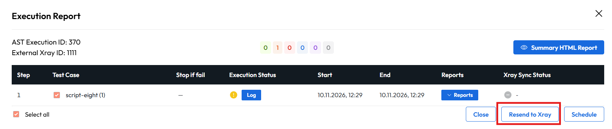
<figcaption><strong>Execution Report</strong> window with selected test cases and the <strong>Resend to Xray</strong> button</figcaption>

### JSON payload

Below is an example of a JSON payload sent to Xray for a single test case:

~~~JSON
{
  "testExecutionKey": "PROJ-2000",
  "tests": [
    {
      "testKey": "PROJ-1042",
      "start": "2025-10-23T10:27:09+02:00",
      "finish": "2025-10-23T10:29:33+02:00",
      "status": "FAIL",
      "comment": "*Test Execution Info*\n || Key || Value ||\n | Testcase ID | 260 |\n  | Testcase Name | stex_13.xml |\n  | Testcase Link | 127.0.0.1:8080/testcase-repository/260 |\n  | Test Set ID | 41 |\n  | Test Set Name | reporting_test |\n  | Test Set Link | 127.0.0.1:8080/test-sets/41 |\n  | Execution Instance | INSTANCE_DEV |\n ",
      "evidences": [],
      "customFields": [
        {
          "id": "customfield_10021",
          "value": "|| Type || User || Description || Operation Type || Err.Message || Status || CreationTime ||\n"
        },
        {
          "id": "customfield_10022",
          "value": "127.0.0.1:8080/api/execution/scripts/ast/report/retrieve/by/deeplink/?reportDownloadKey=KN2jJBjKp2v8RLcbBbdWdiSAJpOMQBSFMRWLUdIDxcpuFzBckZ8xD4zPFomD7p4Az39god0GsCDbggUb9TMEVQM7rjm3hDAR8EeC&mimeTypeString=text%2Fhtml"
        }
      ],
      "defects": ["PROJ-3001"]
    }
  ]
}
~~~

| Field              | Content                                                                                                                                   |
|--------------------|-------------------------------------------------------------------------------------------------------------------------------------------|
| `testExecutionKey` | The Jira Xray Execution ID entered when scheduling.                                                                                        |
| `testKey`          | The External Xray ID of the test case, or `null` if none is assigned.                                                                      |
| `start` / `finish` | Start and end time of the test case in ISO 8601 format (time zone Europe/Zurich). For skipped test cases both contain the time of skipping. |
| `status`           | The Xray status resolved via the [Status mapping](#status-mapping).                                                                        |
| `comment`          | Table with the test case and test set IDs, names and links and the execution instance, in Jira wiki markup.                                 |
| `evidences`        | Always empty.                                                                                                                              |
| `customFields`     | The Test Run custom fields defined in the [Custom fields](#custom-fields) mapping. The example uses the environment variable example from that section: `customfield_10021` contains the test steps table and `customfield_10022` the link to the HTML report. Empty if no mapping is configured. |
| `defects`          | Keys of the defects already linked to the test run in Xray.                                                                                |

The links in the payload are based on the **Web domain** configured in [Administration](admin.md#configuration), followed by the [context path](deployment.md#setting-a-custom-context-path) if one is set.
