# Test Case Repository

Click 'Tests' tab on the [navigation](navigation.md) panel to go to test repository. This chapter describes the functionality and how to navigate basic features of test case repository.

## Interface overview

The interface of AST is divided into three main areas:

1. **left-hand navigation panel** with file tree structure and filtering options

2. **central content area** with test content administration functionalities and user-specific options.

3. **right-hand side panel** with test case version information and details

The interface provides hierarchical navigation for test scripts and a central content area for viewing and editing the XML-based test logic.

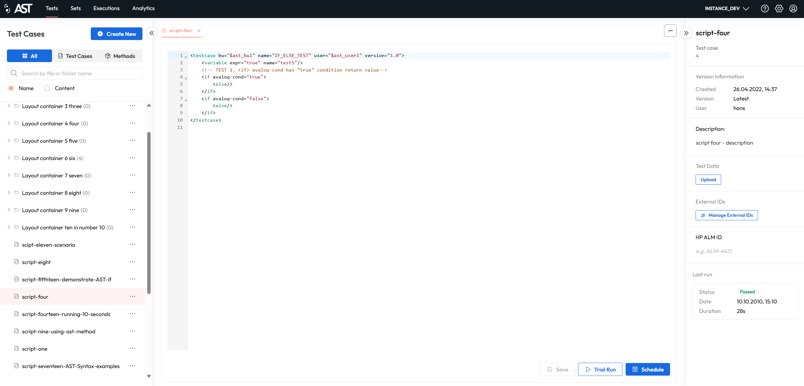
<figcaption>Test Case Repository displaying the hierarchical tree of test cases and the XML editor pane with the version information on the right</figcaption>

!!! info
    Both the left-hand navigation panel and the right-hand side panel are collapsible, allowing users to maximize the central content area when needed for a more focused view on test case details and editing.
  
## Managing Test Cases

The tree display provides a clear and organized view of the entire test case repository. 
This hierarchical structure allows users to browse through different categories and sub-categories of tests, akin to a file system. 

Each folder within the tree is labeled with a descriptive name (of the user's choosing) and includes a count of the test cases it contains, giving the user an immediate sense of the repository's scope.

Users can create, modify, or delete folders, test cases, or methods.
To work with test cases or folders, click on the three dots. Then you see the **[context menu](#create-edit-and-manage-test-cases)** with all the functionalities.

### Version information and details panel

When a test case is opened, the main content area of the control panel populates with its details and controls.
In the right panel you can see its version information like creation date, who created this version and the version number. 
When the newest available version is shown, the version is labeled as 'latest' and the version number is not shown.

You can also see the last run status of this testcase. 

In this section you can also modify the name of the test case and its description.

When Xray or ALM integration is set up, you can also see and edit the linked external IDs. The bulk upload and download of external IDs is available to administrators in [Admin → Configuration](admin.md#manage-external-ids).

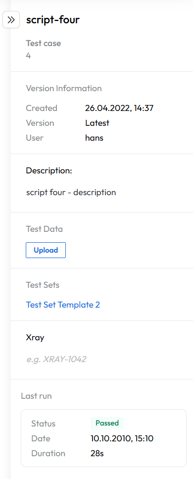
<figcaption>Detailed view of a selected test case information, external IDs, the last run and the button where you can upload test data.</figcaption>

The last run status is clickable and opens a dialog where you can download the execution report.

#### Test case data
Test data can also be uploaded in this section. You can also download the data file that is currently in use or remove it.

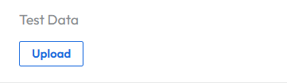
<figcaption>View of the right panel when no test data is attached to the testcase</figcaption>

!!! warning
    Uploading a new Excel file removes the old one. There can be only one data file in use!

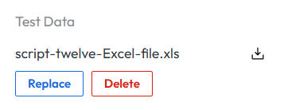
<figcaption>View of the right panel when test data is attached to the testcase. You can replace, remove, or download the test data file</figcaption>

To learn more about test data, please read **[Test script and test data design](test_script_and_test_data.md)**.

#### Test set membership
The **Test Sets** section in the right panel shows all [test sets](test_sets.md) that contain the opened test case. This lets you see where a test case is used, for example before you change or delete it.

The section is shown only for test cases, not for methods.

The test sets are listed alphabetically by name. Each name is a link: click it to open the test set in the [Test Sets](test_sets.md) screen. If a name is too long to fit, it is shortened, and you can hover over it to see the full name.

If the test case is deactivated in a test set (the **Deactivated** checkbox in the [Definitions tab](test_sets.md#definitions-tab)), a **Suspended** label is shown next to the name of that test set. A deactivated test case is still part of the test set, but it is not executed.

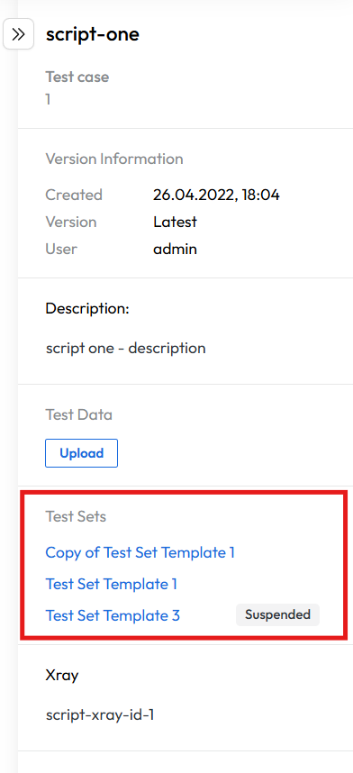
<figcaption>Test Sets section in the right panel listing the test sets that contain the test case</figcaption>

The following messages can be shown instead of the list:

| Message                        | Meaning                                                                                       |
|--------------------------------|-----------------------------------------------------------------------------------------------|
| Not part of any test set       | No test set contains the test case. This is also shown for a new test case that is not saved yet. |
| Test sets could not be loaded  | The list could not be loaded. Reopen the test case to try again.                              |

!!! info
    Up to five test sets are visible at once. If the test case is part of more test sets, scroll inside the section to see the rest.

The list is updated automatically when a test set is created, changed or deleted, for example when you add the test case to a test set via [Create New Test Set or Add to Existing Test Set](#test-case-context-menu).

### Execution Reporting

After a test case has been executed, a user can access its detailed report. You can access it by clicking on the last run status in test case details.
This report offers different formats for download (Log, HTML, XML, Excel).

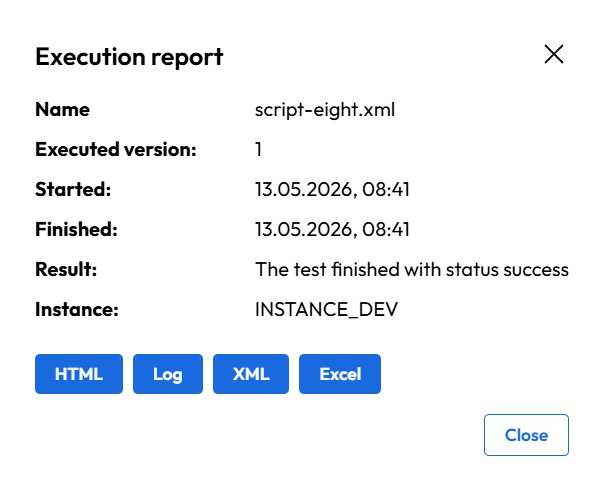
<figcaption>Execution report display from quick access of test case details</figcaption>

### Editor features
To see the testcase content you can single click on a testcase. This will open the testcase in the preview mode. 
If you single click another testcase while having one already opened in preview mode, the previous one will be closed and the new one will be opened in preview mode.

To pin the testcase, double-click it. In this mode the testcase will be pinned, and you can open another testcase in preview mode without closing the pinned one.
If you start to edit a testcase opened in preview mode it will be automatically pinned.

Testcase in preview mode is indicated by the name in italic in the test case tabs, while pinned one is indicated by the name in normal font.

The actions bar at the bottom provides critical functionalities for interacting with the selected test case:

1. **Save** modifications

2. **Trial Run** (test run)

3. **Schedule** (schedule execution)

These controls are essential for a user's workflow, allowing for quick validation and execution of a test without leaving the screen.

Furthermore, a dedicated panel on the right side of the interface provides additional metadata and high-level actions for the selected test. 
This section summarizes key information like the File Name and Path of the test case, offering a quick reference.

This multi-pane layout ensures that the user has a complete overview of the test case's location, content, and available actions all in one view.

#### Concurrent editing

When a user is editing a testcase and at the same time another user has the testcase opened, the application will display
a banner to the second user that shows that the first user is editing the testcase. The second user can still edit the testcase.

The banner serves as a notification only. Whichever user saves last, their version becomes the latest.
It is still possible to see the previous versions of the testcase in the [test case history](#test-case-history).

The banner will disappear when the user that is editing saves or discards their changes. 
It will also disappear after a certain time of inactivity from the user that is editing.

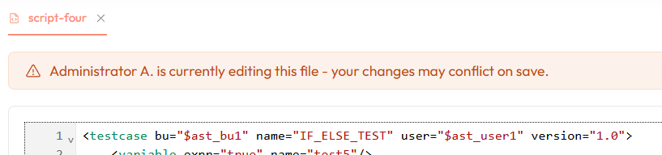
<figcaption>Banner showing the user that is editing the file</figcaption>

#### Trial Run vs Schedule
The **Trial Run** feature allows users to execute the test case immediately. 
A [trial run window](#trial-run-window) is displayed where you can see the logs of the execution in real-time. 
This is useful for quick validation of the test case logic. No reports are generated for trial runs, and the execution is not recorded in the system.

The **Schedule** feature allows users to schedule the execution of the test case for a later time or date. This execution is recorded in the system, and reports are generated for it.
It can be visible in the [Executions](executions.md) tab, where you can see all scheduled and executed runs.

#### Trial run window
When you click **Trial Run**, a logs panel opens at the bottom of the editor. Each trial run is shown in its own window (a tab in this panel) named `Execution: <test case name> (<number>)`. 
The number increases with every trial run you start, so you can tell runs of the same test case apart.

!!! info
    An Avaloq instance must be selected in the header dropdown before you can start a trial run. Otherwise a warning is shown and the trial run is not started.

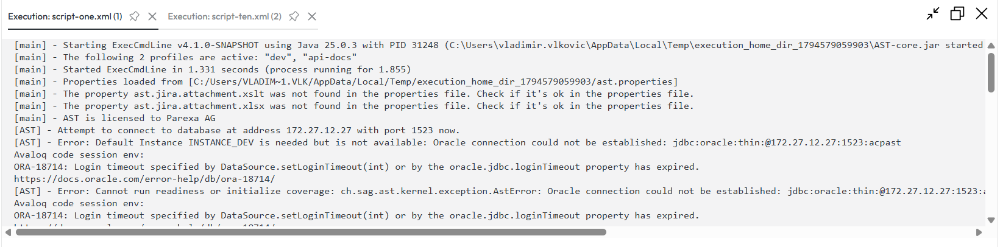
<figcaption>Trial run logs panel with one window per trial run</figcaption>

The window shows *Waiting for execution to start…* until the first log lines arrive. After that the log is updated in real-time:

- The log automatically scrolls to the newest lines. If you scroll up to read an older part, automatic scrolling stops. Scroll back to the bottom to resume it.
- When the execution has finished, the notification *Execution completed* is shown.
- If the trial run cannot be started, the window shows the error message and the notification *Trial run failed.* is shown.

**Window behaviour**

- Every test case has its own window. Running a test case again replaces its previous window, unless that window is [pinned](#pinning-trial-run-windows). Windows of other test cases are not affected.
- When you switch to another test case in the editor, its most recent trial run window is selected automatically. You can also click any window to select it.
- The windows stay open when you navigate to another page, for example to [Executions](executions.md), and come back to the Tests page.
- To close a single window, click the **X** next to its name. To close the whole panel together with all its windows, click **Close** on the right side of the panel.

!!! warning
    A trial run is stopped automatically when its log is no longer being followed, for example when you close its window, close the whole panel or close the browser tab.

**Panel controls**

| Control         | Description                                                                                     |
|-----------------|-------------------------------------------------------------------------------------------------|
| Resize          | Drag the top edge of the panel up or down to change its height                                  |
| Collapse/Expand | Hides the log content and leaves only the window names visible, or shows the log content again. |
| Copy            | Copies the log of the selected window to the clipboard.                                         |
| Close           | Closes the panel and all its windows, including pinned ones.                                    |

##### Pinning trial run windows
Pin a window when you want to keep its log, for example to compare the results of the current run with a previous run of the same test case.

To pin a window, click the pin icon next to its name. A pinned window has a filled pin icon. Click the icon again to unpin the window. Hover over the icon to see the **Pin** or **Unpin** tooltip.

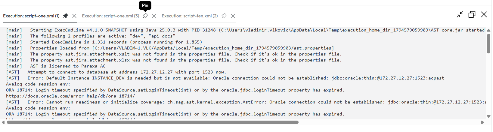
<figcaption>A pinned trial run window next to the newer run of the same test case</figcaption>

When you run a test case again:

- Its pinned windows stay open.
- Its unpinned window, if there is one, is replaced by the window of the new run.
- The new window is placed right after the other windows of the same test case, so all runs of one test case stay next to each other.
- The new window is selected. When you later switch back to this test case, its most recent run is selected, not the pinned one.

You can pin several windows of the same test case to keep the logs of multiple runs. A pinned window can still be closed with the **X** next to its name. If you unpin a window, it stays open until you run the test case again.

### Additional editor features

Test case editor offers another set of useful functionalities that help you with code checking, version comparison and data upload. These are accessible in the upper right part of the editor by clicking the three dots button.
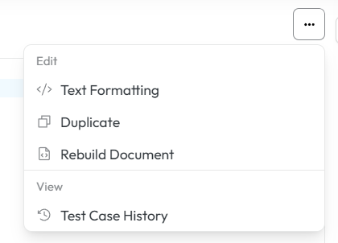

#### Text formatting
Text formatting helps you check how the document would look after formatting rules are applied, without permanently changing it. It helps you preview spacing, indentation, and layout issues to confirm the formatting is correct before saving or publishing.

#### Duplicate
Duplicate creates an exact copy of the testcase. This is useful for creating similar test cases without starting from scratch, allowing you to modify the duplicate while keeping the original intact.

#### Rebuild document

Rebuild document reprocesses the entire file from scratch. The editor re-parses the document, re-applies structure, references, and validations to make sure everything is consistent and up to date. It’s typically used after major changes or when the document gets out of sync.

#### Test case history

Test case history displays all edited and saved versions of the displayed document.
You can view all of these in the editor, change them, and compare changes with selected versions.

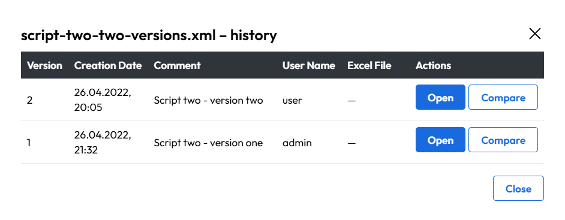
<figcaption>History of all saved changes to the test case</figcaption>

To compare different versions click the button with corresponding name and select version from dropdowns which you want to compare.
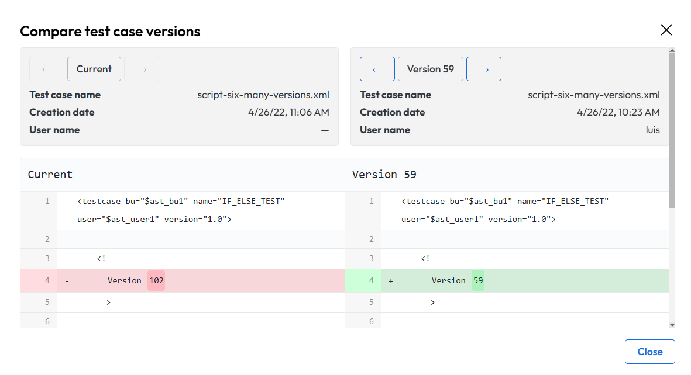
<figcaption>Compare functionality</figcaption>

## Create, edit and manage test cases

Creating a new test case or folder is possible via the Create New button.

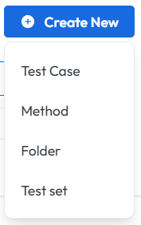
<figcaption>Create new test case or folder or other</figcaption>

Moving test cases, folders, and methods is possible via drag and drop or via the context menu. 
To move an item using drag and drop, simply click and hold the item you wish to move, then drag it to the desired location in the tree structure and release it. 
The interface will provide visual cues to indicate valid drop targets.

To drag and drop multiple items at once, hold down the Ctrl key (or Command key on Mac) while selecting the items you want to move. 
You can also hold down the Shift key to select a range of items.
Then, click and hold one of the selected items, drag them to the desired location, and release to drop them together.

Other functionalities are available via the context menu, which can be accessed by clicking on the three dots next to each folder, test case or method.

### Folder context menu

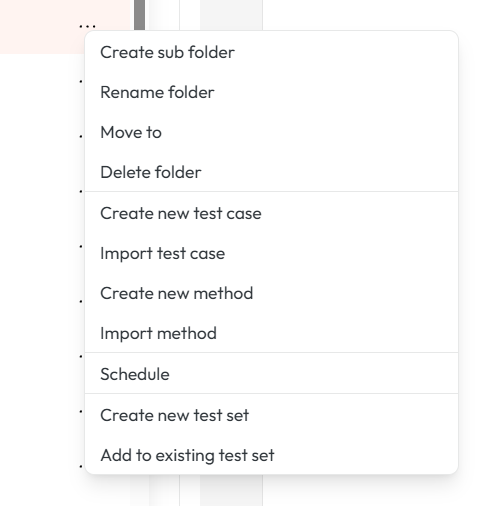
<figcaption>Folder specific context menu</figcaption>

| Actions for folder       | Description                                                                                |
|--------------------------|--------------------------------------------------------------------------------------------|
| Create sub folder        | Creates new sub folder in selected folder                                                  |
| Rename folder            | Renames selected folder                                                                    |
| Move to                  | Opens a dialog to move selected folder to another location in the tree structure.          |
| Delete folder            | Permanently deletes selected folder                                                        |
| Create new test case     | Creates new test case in selected folder                                                   |
| Import test cases        | Imports test case into selected folder from file.                                          |
| Create new method        | Creates new method in selected folder                                                      |
| Import methods           | Imports new method from file                                                               |
| Schedule                 | Opens a dialog to schedule a single execution or a series of executions for the test case. |
| Create New Test Set      | Allows the user to create a new group or suite and add the current test case to it.        |
| Add to Existing Test Set | Enables the user to add the selected test case to an already existing test set.            |

### Test case context menu

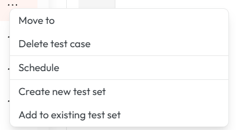
<figcaption>Test case specific context menu</figcaption>

| Actions for Test case    | Description                                                                                |
|--------------------------|--------------------------------------------------------------------------------------------|
| Move to                  | Opens a dialog to move selected testcase to another location in the tree structure.        |
| Delete Test Case         | Permanently removes a test case from the repository. Note: This action cannot be undone.   |
| Schedule                 | Opens a dialog to schedule a single execution or a series of executions for the test case. |
| Create New Test Set      | Allows the user to create a new group or suite and add the current test case to it.        |
| Add to Existing Test Set | Enables the user to add the selected test case to an already existing test set.            |

### Method context menu

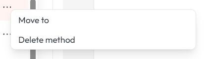
<figcaption>Method specific context menu</figcaption>

| Actions for Method | Description                                                                           |
|--------------------|---------------------------------------------------------------------------------------|
| Move to            | Opens a dialog to move selected method to another location in the tree structure.     |
| Delete Method      | Permanently removes a method from the repository. Note: This action cannot be undone. |

!!! info
    The name and description of the test cases and methods can also be edited in the right panel when the test case is opened. This allows for quick updates to metadata without needing to access the context menu.

To learn how to write test case scripts, please read **[Test script and test data design](test_script_and_test_data.md)**. 